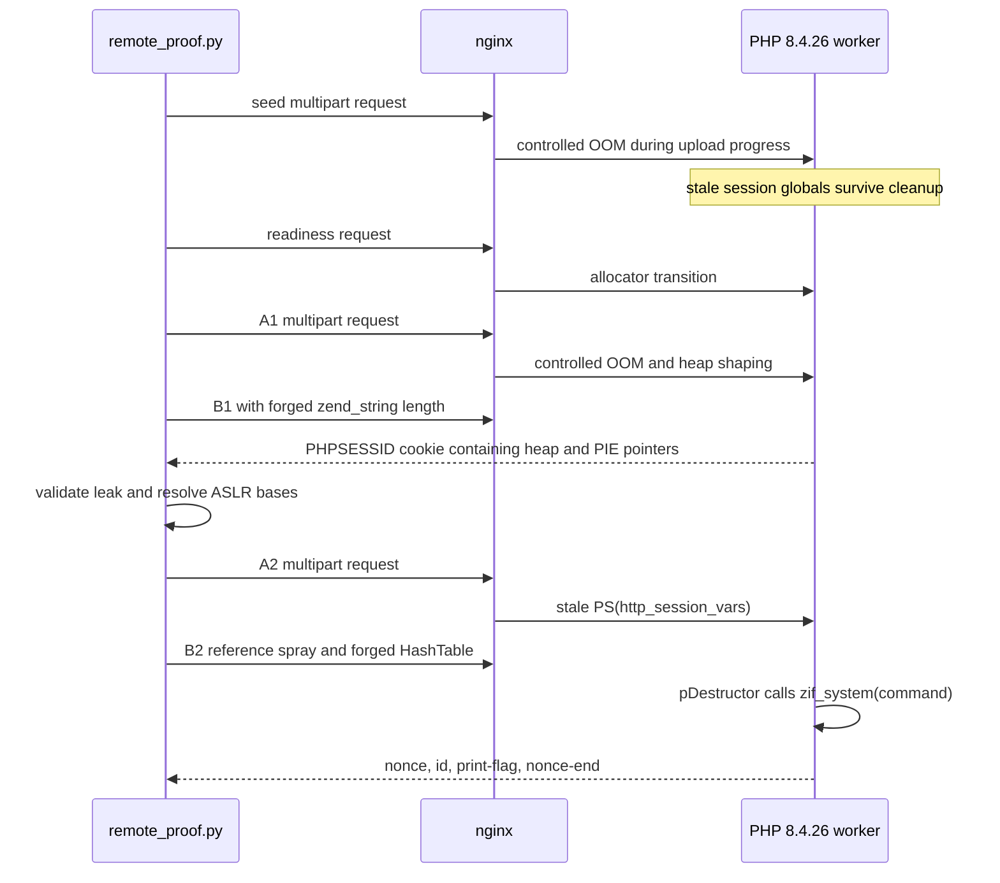

# Steal My Bitcoin: independent php2shell exploit

End-to-end proof of concept for the PHP 8.4.26 request-cleanup bugs commonly
called **php2shell**. The exploit leaks Zend heap and PHP PIE addresses, builds
a forged `HashTable`, redirects its destructor to `zif_system`, and executes
`print-flag` as the PHP user.

The repository includes a reproducible Docker lab, an nginx multi-worker
runner, the remote runner used against the CTF, and evidence from the successful
public run.

## Verified remote result

Remote code execution was confirmed against `https://old.stealmybitcoin.com`
on 27 October 2026.

| Field | Value |
|---|---|
| GitHub Actions run | [`40428614981`](https://github.com/Erwann9875/stealmybitcoin-ctf-attempt/actions/runs/40428614981) |
| Source commit | `b021188198c73b39f7dfee33b56fdc00234e0e65` |
| Successful attempt | 2 |
| HTTP statuses | `200/200/200/200/200/200` |
| PHP identity | `uid=82(www-data) gid=82(www-data)` |
| `print-flag` output | `practice{challenge_already_won}` |

```text
attempt=2 statuses=200/200/200/200/200/200
main=0x7fd5eee00000 php=0x55ee2e200000 zif_system=0x55ee2e70dd70
response=uid=82(www-data) gid=82(www-data) groups=82(www-data)
practice{challenge_already_won}
RESULT=REMOTE_RCE_CONFIRMED
```

The challenge had already been won, so `print-flag` returned the practice
marker instead of the original wallet secret. The response still proves code
execution: it contains a fresh nonce, the process identity, a non-empty
`print-flag` result, and the final nonce marker generated for that request.

The durable transcript, artifact digest, source commit, and run links are in
[`remote-proof-success.log`](remote-proof-success.log).

## Exploit flow



The requests use ordinary HTTP/1.1 with `Content-Length`. The exploit does not
use request smuggling, chunked-transfer ambiguity, or a `post_max_size` bypass.
Every request body remains below the one MiB challenge limit.

## Request sequence

| Stage | Size | Purpose | Required result |
|---|---:|---|---|
| seed | 305,042 bytes | Enter session upload-progress handling and leave stale request state after a controlled OOM | PHP memory-limit error |
| readiness | no body | Preserve the calibrated allocator transition and verify PHP 8.4.26 | HTTP 200 |
| A1 | 1,045,243 bytes | Shape ZendMM bins and leave stale session identifiers | PHP memory-limit error |
| B1 | 339,678 bytes | Reclaim the stale string and overwrite its length | Exact 1,088-byte decoded cookie |
| A2 | 279,369 bytes | Leave a stale `PS(http_session_vars)` reference | PHP memory-limit error |
| B2 | 451,384 bytes | Spray references and supply a forged `HashTable` | Verified command callback |

The largest body is A1 at 1,045,243 bytes, 3,333 bytes below the configured
one MiB limit.

## Vulnerability model

The chain combines the request-cleanup primitives described as
CVE-2026-109618 and CVE-2026-109619. PHP processes session upload progress while
it is still parsing multipart fields. Carefully selected nested field names and
values exhaust the 128 MiB memory limit inside that path.

The affected bailout path behaves like a non-local jump. Request-owned session
globals are not fully reset before the long-lived CLI server accepts another
request. Values such as `PS(id)`, `PS(mod_data)`, and
`PS(http_session_vars)` can therefore point into memory that a later request
reuses.

### Address disclosure

B1 reclaims the stale A1 session identifier. Its first query value contains a
forged `zend_string` length:

```text
"V" * 7 || little_endian_u64(0x440) || "a"
```

PHP URL-encodes the corrupted identifier into the `PHPSESSID` response cookie.
The resulting 1,088-byte disclosure contains neighbouring allocator data. The
parser accepts it only when:

- at least four heap-looking pointers agree on one 2 MiB-aligned Zend chunk;
- a code pointer matches a known PHP 8.4.26 build offset;
- subtracting that offset yields a 2 MiB-aligned PIE base.

The remote Alpine profile uses these independently derived offsets:

| Symbol or object | Offset |
|---|---:|
| `zval_ptr_dtor` PIE anchor | `0x712930` |
| `zif_system` | `php_base + 0x50dd70` |
| forged `HashTable` | `main_chunk + 0x0f5398` |

These offsets are specific to the pinned Alpine PHP 8.4.26 binary. A version
string alone is not enough to identify a compatible build.

### Code execution

B2 sprays fake `zend_reference` objects around a controlled 384-byte value.
That value overlaps three Zend structures:

```text
S + 0x00  zend_array / HashTable
S + 0x20  bucket and fake call frame
S + 0x30  pDestructor = zif_system
S + 0x80  zend_string header
S + 0x98  command bytes
```

When PHP releases the reclaimed stale reference, it reads the forged array
destructor and invokes `zif_system`. The remote command is nonce-delimited and
runs `id` followed by `print-flag`. A response is accepted only when HTTP 200,
both nonce markers, `uid=`, and non-empty flag output are present.

## nginx and worker affinity

The exploit state belongs to one PHP process. Sending consecutive requests to
different workers combines unrelated heap and PIE addresses and invalidates the
forged pointers.

`remote_proof.py` keeps one HTTP/1.1 connection open and pipelines two groups:

1. seed, readiness, A1, and B1;
2. A2 and the address-dependent B2.

The Docker lab hashes nginx upstream selection from the downstream connection,
so every stage reaches the same PHP replica. An HTTPS interception proxy can
break this property by pooling each origin request independently. The verified
remote run therefore used `--direct` from GitHub Actions.

The public index is static HTML and does not enter PHP. Exploit requests target
`/ping.php`; `/php-version.php` is used for readiness and build validation.

## Reproduction

Requirements:

- x86-64 Linux;
- Python 3.10 or newer;
- Docker with Compose for the local lab;
- an authorized PHP 8.4.26 target matching one of the binary profiles.

### nginx multi-worker lab

```bash
docker compose up -d --build
python3 remote_proof.py \
  --target http://127.0.0.1:18083 \
  --profile alpine \
  --direct \
  --attempts 12
docker compose down
```

The lab starts nginx and five independently supervised PHP CLI-server
containers. Success writes the selected proof log and prints
`RESULT=REMOTE_RCE_CONFIRMED`.

### Original single-worker lab

```bash
docker build -t php2shell-local:8.4.26 .
docker rm -f php2shell-local-proof 2>/dev/null || true
docker run -d \
  --name php2shell-local-proof \
  -p 127.0.0.1:18082:8000 \
  php2shell-local:8.4.26
python3 local_proof.py --attempts 12
```

This runner restarts the local container before each attempt and writes
`RESULT=LOCAL_RCE_CONFIRMED` only after the local `print-flag` marker returns.

### CTF runner

The command used by the successful workflow was:

```bash
python3 remote_proof.py \
  --direct \
  --attempts 4 \
  --timeout 20 \
  --retry-delay 5 \
  --leak-length 0x440 \
  --pre-parameters 8 \
  --b1-fillers 5 \
  --worker-stride 1
```

The equivalent manual workflow invocation is:

```bash
gh workflow run remote-proof.yml \
  -f leak_length=0x440 \
  -f pre_parameters=8 \
  -f worker_stride=1 \
  -f b1_fillers=5
gh run watch
```

The workflow is manual and read-only with respect to repository contents. It
uploads `remote-leak.bin` and `remote-proof.log` as a one-day evidence artifact.

## Evidence and success criteria

The runners do not treat an OOM, crash, leak, or HTTP 502 as code execution.

| Result | Interpretation |
|---|---|
| ordinary 32-byte session cookie | B1 reached a worker without the required stale A1 state |
| exact 1,088-byte cookie | the bounded disclosure occurred |
| missing heap or PIE anchor | disclosure was insufficient or the binary profile did not match |
| HTTP 400 | the request was rejected before a usable B1 result |
| HTTP 502 | nginx lost the PHP upstream or rejected its response |
| nonce and `uid=` without a final marker or flag | command proof is incomplete and rejected |
| `RESULT=REMOTE_RCE_CONFIRMED` | all stages and the `print-flag` callback passed validation |

Recorded evidence:

| File | Result |
|---|---|
| [`proof.log`](proof.log) | original single-worker Docker RCE |
| [`nginx-proof.log`](nginx-proof.log) | five-worker nginx Docker RCE |
| [`restart-proof.log`](restart-proof.log) | local hot-worker restart investigation |
| [`remote-proof-success.log`](remote-proof-success.log) | verified CTF execution and public run metadata |

`restart_proof.py` is a local research tool. It deliberately terminates a PHP
worker to study supervised recovery and is not part of the remote workflow.

## Repository layout

| Path | Purpose |
|---|---|
| `exploit_primitives.py` | Multipart builders, Zend layouts, binary profiles, and leak parsing |
| `exploit_chain.py` | Deterministic seed, A1, B1, and A2 payload set |
| `http_transport.py` | Persistent pipelined HTTP/1.1 and CONNECT proxy transport |
| `remote_proof.py` | nginx multi-worker and CTF runner |
| `local_proof.py` | original single-worker Docker proof |
| `restart_proof.py` | local supervised-restart research runner |
| `compose.yaml` | nginx and five PHP replica lab |
| `Dockerfile.alpine` | pinned Alpine PHP 8.4.26 image |
| `lab/` | static index and PHP endpoints used by the lab |
| `.github/workflows/remote-proof.yml` | manually dispatched direct-network run |

The implementation uses the Python standard library and contains no external
runtime dependency.

## Scope and limitations

- The demonstrated target is the long-lived PHP CLI-server SAPI. In local FPM
  testing, the controlled OOM terminated the FPM child, which discarded the
  stale globals before B1.
- The memory layout is build-specific. PHP 8.4.26 packages from different
  distributions can use different function and heap offsets.
- Backend affinity is required from seed through B2.
- The target must allow multipart bodies close to one MiB and use the expected
  128 MiB PHP memory limit.
- `mbstring.encoding_translation` is not required.

## Remediation

Upgrade PHP. The first fixed releases are 8.2.35, 8.3.36, 8.4.27, and 8.5.12.
Disabling session upload progress or recycling workers can reduce exposure
during rollout, but neither replaces the security update.

## Research provenance

The initial implementation was committed as
`5db38b8fd7f9f959465eb90648614a7e037ed47f` before the later comparison with
KillaBoi's StealMyBitcoin PoC. The branch was returned to that independent
state before the nginx transport, allocator calibration, and verified remote
run were completed. No source or payload from that repository is included
here.

The work was derived from PHP source and advisories, the public NCSC-NL
php2shell material, 9bie's ASLR-bypass research, binary inspection of the
pinned Docker images, and black-box testing of the CTF endpoint.

## References

- [Verified GitHub Actions run](https://github.com/Erwann9875/stealmybitcoin-ctf-attempt/actions/runs/40428614981)
- [PHP security advisory, 21 October 2026](https://www.php.net/archive/2026.php#2026-10-21-5)
- [PHP source](https://github.com/php/php-src)
- [NCSC-NL php2shell operational information](https://github.com/NCSC-NL/php2shell)
- [9bie php2shell ASLR-bypass research](https://github.com/9bie/php2shell-bypass-aslr-exp)
- [OpenAI PHP version checker](https://github.com/openai/php2shell-checker)
- [Steal My Bitcoin terms of participation](https://old.stealmybitcoin.com/terms.html)
