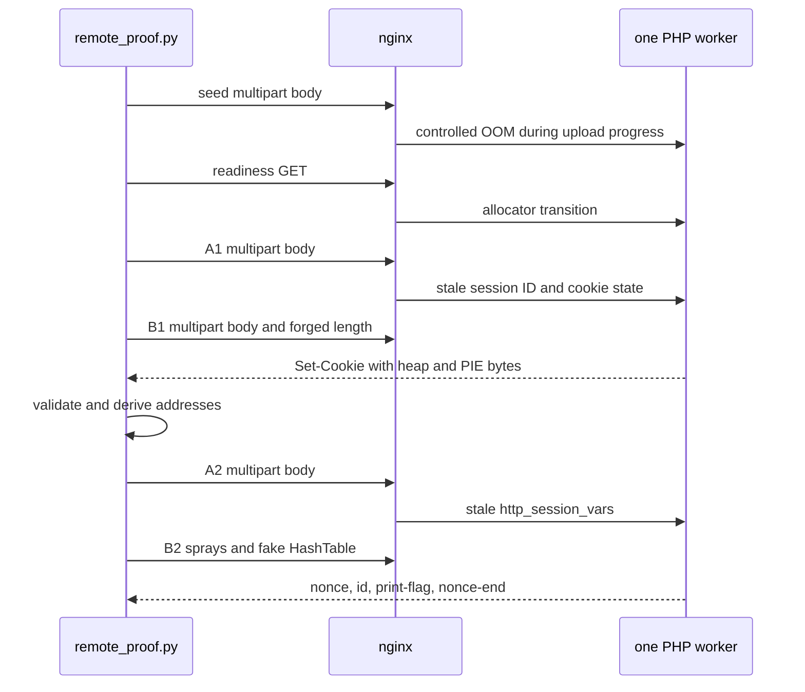

# Independent php2shell CTF proof for PHP 8.4.26

This repository contains an end-to-end reproduction of the PHP request-cleanup
and stale-global-state exploit chain commonly called **php2shell**. It includes
both the original single-worker proof and a persistent HTTP transport that runs
the same payload chain through nginx in front of multiple PHP workers.

The proof reaches a controlled `system()` call and executes `print-flag`. It
does not treat a crash, an OOM, a leaked cookie, or an HTTP 502 as proof of code
execution.

The current implementation has three recorded local results:

- [`proof.log`](proof.log) records the original single-worker Docker proof;
- [`nginx-proof.log`](nginx-proof.log) records the same exploit behind nginx
  with five independently supervised PHP workers;
- [`restart-proof.log`](restart-proof.log) records the complete hot-worker,
  supervised-restart, leak, and `print-flag` chain.

`remote_proof.py` writes a separate `remote-proof.log` only after it receives a
200 response containing two random nonce markers, `id` output, and the output
of `print-flag`.

## Research provenance

The payload implementation in this repository predates the comparison with
the other Steal My Bitcoin solution discussed during the investigation. Git
commit `5db38b8fd7f9f959465eb90648614a7e037ed47f` is the last repository state
from before that comparison. The current branch was reset to that commit before
the nginx and persistent-connection work in this version began.

The current correction keeps the original seed, A1, B1, A2, and B2 payloads.
It was developed from local Docker experiments, PHP binary inspection, nginx
behavior, and black-box responses from the CTF. No source or payload from the
other challenge repository is present here.

The research inputs used before that comparison were PHP source, the public PHP
advisory, NCSC-NL's operational material, 9bie's ASLR-bypass research, and the
OpenAI version checker. They are listed under [References](#references).

## What changed for nginx and multiple workers

The initial proof opened a new TCP connection for every request. That is
deterministic for one `php -S` worker after a container restart, but unreliable
behind nginx because consecutive requests can reach different workers.

The new runner opens one HTTP/1.1 connection and uses two bounded pipelines:

1. send seed, readiness, A1, and B1 in one socket write;
2. read and validate their four responses in order;
3. derive the heap and PHP addresses;
4. send A2 and the address-dependent B2 in one socket write;
5. read and validate both responses and the command callback.

Queuing the next request before the previous response returns to the client
removes the network gap in which another visitor could take the recently idle
PHP worker. `--sequential` remains available for transport diagnostics.

The compose lab hashes nginx's upstream choice from the downstream connection,
so one persistent client connection stays on one of five PHP containers. On the
remote CTF, a direct connection also removes the extra request pool introduced
by an HTTPS interception proxy. The server's worker scheduling is still not a
protocol guarantee, so the runner validates every stage and retries the
complete chain when another worker answers.

This method succeeded in the five-worker local lab without a
manual restart:

```text
attempt=2 statuses=200/200/200/200/200/200
main=0x7fc98e800000 php=0x558609000000 zif_system=0x55860950dd70
response=uid=0(root) gid=0(root)
LOCAL_PHP2SHELL_RCE_PROOF uid=0 gid=0
RESULT=REMOTE_RCE_CONFIRMED
```

An HTTPS interception proxy can defeat this property even though the client
connection remains open. The proxy may terminate TLS and independently pool
each origin request. `--direct` disables environment proxy discovery when a
direct route is available. The manual GitHub workflow uses that mode.

## Repository layout

| Path | Purpose |
|---|---|
| `Dockerfile` | Builds the pinned PHP 8.4.26 lab image. |
| `Dockerfile.alpine` | Builds the Alpine cli-server image used by the nginx lab. |
| `compose.yaml` | Starts nginx and five supervised PHP replicas. |
| `lab/nginx.conf` | Proxies ordinary HTTP/1.1 requests to the PHP server. |
| `lab/index.html` | Static page that deliberately bypasses PHP. |
| `lab/php-version.php` | Readiness and version endpoint. |
| `lab/ping.php` | Harmless PHP endpoint used for exploit requests. |
| `print-flag` | Local proof command that prints the container UID and GID. |
| `exploit_primitives.py` | Multipart builders, forged Zend layouts, binary profiles, and leak parsing. |
| `exploit_chain.py` | Deterministic payload set, exact sizes, and request-size validation. |
| `http_transport.py` | Persistent pipelined HTTP/1.1 client with optional CONNECT proxy support. |
| `lab_runtime.py` | Docker lifecycle and one-shot local HTTP helpers. |
| `local_proof.py` | Original restart-based single-worker proof. |
| `remote_proof.py` | Persistent multi-worker and remote proof runner. |
| `restart_proof.py` | Restart-assisted proof for an already hot supervised worker. |
| `.github/workflows/remote-proof.yml` | Manually dispatched direct-network proof run. |

The Python source contains no explanatory comments or docstrings. The protocol
and memory-layout explanation lives in this document.

## Reproduce the original proof

Requirements are an x86-64 Linux Docker host, Python 3.10 or newer, Docker
access, and local port 18082.

```bash
docker build -t php2shell-local:8.4.26 .
docker rm -f php2shell-local-proof 2>/dev/null || true
docker run -d \
  --name php2shell-local-proof \
  -p 127.0.0.1:18082:8000 \
  php2shell-local:8.4.26
python3 local_proof.py --attempts 12
```

The original runner restarts the named container for each attempt. Success
requires all of these checks:

1. seed, B1, and A2 contain the expected PHP memory-limit error;
2. B1 yields an exact 2,048-byte decoded cookie with recognized heap and PIE
   pointers;
3. B2 returns HTTP 200 and `LOCAL_PHP2SHELL_RCE_PROOF`.

It then writes `RESULT=LOCAL_RCE_CONFIRMED` to `proof.log`.

## Reproduce the nginx multi-worker proof

The compose lab exposes nginx on `127.0.0.1:18083`. Compose starts five
single-worker PHP replicas. nginx consistently hashes all requests from one
client connection to one replica, while a new attempt can select another.

```bash
docker compose up -d --build
python3 remote_proof.py \
  --target http://127.0.0.1:18083 \
  --profile alpine \
  --direct \
  --attempts 12
docker compose down
```

This runner never calls Docker and never requests a target restart. A failed
attempt opens a new client connection and repeats the validated request chain.
The compose service has a restart policy for the case where corruption takes
down the master process, matching the external supervision expected for a CTF
service.

## Reproduce the hot-worker restart-assisted proof

The original bounded leak is deterministic on a newly started worker. A hot
worker has a different allocator history. Local memory inspection established
the exact difference:

- `PS(id)` still points to `main_chunk + 0x59000`;
- a fresh worker has `zval_ptr_dtor` at leak offsets `+0x280` and `+0x398`;
- after one ordinary PHP request, those forward copies are gone;
- three remaining copies sit at approximately `-0xfe8`, `-0xfb0`, and
  `-0xed0`, before the string data and therefore outside a forward over-read.

The hot-worker leak still returns 1,088 bytes and a stable heap cluster, but it
contains no PHP PIE anchor. Increasing the forged length to `0x1000` did not
reach one. Larger values crossed allocator mappings or exceeded practical
upstream-header handling and terminated the worker.

`restart_proof.py` turns that terminating case into a complete network-only
chain. It does not call Docker, access the host, open parallel connections, or
hold workers busy:

1. open one persistent HTTP/1.1 connection and record the selected upstream
   when nginx exposes `X-Upstream`;
2. run seed, readiness, A1, and a crash B1 with a `0x4000` forged length;
3. require nginx to return 502 without closing the downstream connection;
4. wait for supervision to restart the same PHP service and for nginx's
   upstream failure interval to expire;
5. pipeline a second seed, readiness, A1, and bounded B1 as the restarted
   process's first requests;
6. resolve the heap and PHP bases, then pipeline A2 and B2;
7. accept success only after HTTP 200 contains the nonce-delimited `id` and
   `print-flag` output.

The crash and proof phases must not reuse a session ID. The terminating B1 can
leave a nonempty `/tmp/sess_<id>` file inside the PHP container. That file
survives a process restart and changes the second chain's allocator geometry.
The runner therefore generates three independent IDs: one byte for the crash
phase, a different one byte for the leak phase, and 32 bytes for A2/B2. Their
lengths preserve the original ZendMM size classes and all four request sizes.

Run the complete proof against the local five-worker lab:

```bash
docker compose up -d --build
python3 restart_proof.py --direct
docker compose down
```

The recorded run pinned every request to one upstream and produced:

```text
recycle statuses=200/200/200/502 upstream=172.19.0.2:8000
crash_statuses=200/200/200/502
proof_statuses=200/200/200/200/200/200
upstream=172.19.0.2:8000
main=0x7fe5da400000 php=0x55a80e800000 zif_system=0x55a80ed0dd70
response=uid=0(root) gid=0(root) groups=0(root),0(root),1(bin),2(daemon),3(sys),4(adm),6(disk),10(wheel),11(floppy),20(dialout),26(tape),27(video)
LOCAL_PHP2SHELL_RCE_PROOF uid=0 gid=0
RESULT=RESTART_ASSISTED_RCE_CONFIRMED
```

The default target is the local lab. A nonlocal target must explicitly replace
`--target`. The method deliberately terminates one PHP process and relies on
external supervision, a stable downstream-to-upstream mapping, a 502 response
that preserves the client connection, and a restart interval compatible with
`--restart-delay`. It is appropriate only when that behavior is authorized by
the target's rules.

## Run against the CTF endpoint

The remote profile is for the x86-64 Alpine PHP 8.4.26 binary independently
inspected in the lab:

```bash
python3 remote_proof.py \
  --target https://old.stealmybitcoin.com \
  --profile alpine \
  --direct \
  --attempts 12
```

The runner first requires `/php-version.php` to report PHP 8.4.26. It uses
`/ping.php` because that route enters PHP's request lifecycle. On a successful
attempt it saves:

- `remote-leak.bin`, the exact decoded B1 cookie used to derive addresses;
- `remote-proof.log`, the target, profile, stage statuses, derived addresses,
  verified command output, and `RESULT=REMOTE_RCE_CONFIRMED`.

Both files are ignored by Git until deliberately reviewed and added.

The equivalent manual GitHub run is:

```bash
gh workflow run remote-proof.yml
gh run watch
```

The workflow is `workflow_dispatch` only. Its one-day evidence artifact is
uploaded whether the proof succeeds or stops after a validated leak.

The restart-assisted runner is intentionally absent from that workflow. The
published challenge terms prohibit denial of service, resource exhaustion, and
sabotage. Its remote use would deliberately terminate a PHP worker, so the
repository records and explains the local proof without presenting it as a
remote solve or a recovered wallet flag.

`--worker-stride N` interleaves `N - 1` harmless readiness requests between
the exploit stages. It is a bounded scheduler calibration for a server that
rotates connections across a known worker count. The default is `1`; the
workflow exposes 4, 5, and 6 only as explicit manual choices.

## Why the endpoint must reach PHP

The bug runs during PHP request startup, multipart parsing, and request cleanup,
before normal application logic matters. A request still has to be dispatched
to a vulnerable PHP SAPI worker.

`index.html` is static, so nginx can serve it without invoking PHP. A harmless
route such as `ping.php` is sufficient because the exploit does not depend on
the route's application code. It depends on vulnerable PHP 8.4.26 parsing the
multipart request.

## SAPI scope

This exact cross-request chain requires the process that handled the controlled
OOM to accept another request. In a separate test with the official PHP 8.4.26
Alpine FPM image, the OOM made the FPM child exit with code 70. FPM spawned a
fresh child, so the stale globals were lost before B1. The payload in this
repository therefore targets the long-lived `cli-server` SAPI used by the CTF;
it is not a generic PHP-FPM exploit for ordinary shared hosting.

nginx is still relevant as the public reverse proxy. It affects worker
selection, upstream failures, and response-header limits, but it does not make
an FPM worker preserve state after that worker exits.

## Vulnerability model

The chain combines the primitives described as CVE-2026-109618 and
CVE-2026-109619. Session upload progress invokes session code while PHP is
still parsing multipart fields. Carefully selected field counts, nesting, and
value sizes fill ZendMM bins and pages until an allocation fails at the 128 MiB
memory limit.

PHP implements OOM handling as a bailout similar to a non-local jump. In the
affected versions, selected bailout paths do not reset every request-owned
session global before the worker accepts another request. `PS(id)`,
`PS(mod_data)`, and `PS(http_session_vars)` can therefore point into memory
that the next request is free to reuse.



All requests use ordinary HTTP/1.1 with `Content-Length`. The chain does not
use `Transfer-Encoding: chunked`, a request-smuggling discrepancy, or a
`post_max_size` bypass. Every body remains below one MiB.

## Stage 1: seed

The 305,042-byte default seed contains `PHPSESSID=a`,
`PHP_SESSION_UPLOAD_PROGRESS=k0`, one real file with a 32,768-byte field name,
and 880 depth-64 nested empty-file parts. It prepares ZendMM and causes a
controlled OOM while upload progress is active. The worker stays alive.

The restart-assisted runner substitutes another one-byte session ID without
changing the request size or allocation class.

The readiness GET follows the seed. It is part of the calibrated allocator
sequence, not just a health check.

## Stage 2: A1

A1 is 1,045,243 bytes, 3,333 bytes below the one-MiB cap. It contains:

- a one-byte NUL session ID;
- 860 depth-64 nested file names with 87 bytes of key padding;
- Content-Type lengths of 103 and 231 bytes for the first two fields;
- 14 fields shaped for the 128-byte ZendMM bin;
- 78 values of 8,000 bytes and 20 values of 4,000 bytes;
- a 4,000-byte upload-progress value;
- one post-progress file field with a 136-byte name and 88-byte filename.

Eight small query parameters shift early `_GET` allocations. The OOM occurs in
the session reset and cookie path reached through
`php_session_rfc1867_callback`, leaving the session ID and related cleanup
state stale.

## Stage 3: B1

B1 is 339,678 bytes. It begins with 866 tightly encoded nested file parts and
ends with a short session ID and 35-byte progress value. Its first query value
is:

```text
"V" * 7 || little_endian_u64(leak_length) || "a"
```

The original proof uses six more 16-byte values to stabilize the allocation
geometry. Local calibration found useful layouts with 5, 6, 2, and 7 fillers;
five placed an additional PHP code pointer earlier in the bounded leak. The
remote runner cycles those values across attempts. B1 reclaims the stale A1
session ID and forges its `zend_string` length. PHP URL-encodes that ID into
`Set-Cookie`, copying adjacent allocator contents that include heap and PHP PIE
pointers.

Changing the one-byte session ID changes only the session filename and payload
bytes. It does not change B1's size or ZendMM allocation class. This separates
the restart phase's persistent session file from the proof phase.

The single-worker profile uses `0x800`, yielding 2,048 decoded bytes. The nginx
profile defaults to `0x440`, yielding 1,088 bytes. The shorter value keeps the
encoded response header below common nginx upstream-header buffers; the
original 2,048-byte leak can otherwise surface as a 502 even when PHP produced
the cookie.

The parser tries every possible eight-byte alignment. Heap-looking pointers are
grouped by `value & ~0x1fffff`; a PHP base is accepted only when subtracting a
profile anchor produces a 2 MiB-aligned PIE base. It aborts instead of guessing
when either address class is absent.

## Binary profiles and independent offset derivation

The Debian profile used by the pinned original image has these values:

```text
PIE anchors: 0x702260, 0x1231b68
zif_system:  php_base + 0x508a70
```

The Alpine profile was derived from the official PHP 8.4.26 Alpine binary in
the local Docker image. `readelf` identified `zval_ptr_dtor` at `0x712930`.
The built-in function table entry named `system` points to the handler at
`0x50dd70`:

```text
PIE anchor:  0x712930
zif_system:  php_base + 0x50dd70
```

These are build-specific offsets, not universal PHP constants. A different
distribution build requires its own profile. The fake HashTable placement for
the calibrated allocator layout is `main_chunk + 0x0f5398`.

## Stage 4: A2

A2 is 279,369 bytes. It contains 115 short fillers, 880 depth-64 nested file
fields, a 32-byte session ID, and `k0` as the progress value. Its bailout leaves
a stale `PS(http_session_vars)` for B2 to reclaim.

The same 32-byte ID is embedded in B2. `restart_proof.py` generates it per run
so A2 and B2 share state without colliding with the one-byte IDs.

## Stage 5: B2

B2 is 451,384 bytes for every supported command length. It contains 500 spray
fields, one `ht` field, the two session fields, and another 495 spray fields.
The spray places a fake 32-byte `zend_reference` every 32 bytes inside each
384-byte value.

The `ht` value contains a fake `zend_array` whose important fields are:

| Offset | Value |
|---:|---|
| `+0x00` | GC refcount 1 and array type |
| `+0x10` | `arData = S + 0x20` |
| `+0x18` | one used and one live element |
| `+0x30` | `pDestructor = zif_system` |
| `+0x20` | overlapping fake `zend_execute_data` |
| `+0x70` | pointer to the argument at `S + 0x80` |
| `+0x80` | fake `zend_string` containing the command |

When PHP releases the reclaimed stale reference, it calls the fake array's
destructor. The overlapping call frame presents one string argument to
`zif_system`. The local runner uses `print-flag`. The remote runner wraps
`id;print-flag` between unpredictable markers and accepts the response only
when both markers and `uid=` are present.

## Deterministic payload sizes

| Body | Bytes | SHA-256 |
|---|---:|---|
| seed | 305,042 | `5e4967482a422e52564ef554204449cd958193d966c426b4d024c012a4c3dcbb` |
| A1 | 1,045,243 | `90eba9c30857136cf45b8be06f9edd8797df1ae4561e176af09d57b690eadf1e` |
| B1 | 339,678 | `7a1eb050bf3faf9ee098665e42c49e60b9fe5b95d8554775d009682eddc377b7` |
| A2 | 279,369 | `7af66c8f35c5fa6b47a539da6dca361d19543d9f62d61e4af891c2802bd5e236` |

B2 embeds ASLR-derived addresses and therefore has a run-specific hash. A1 is
the largest request and remains below 1,048,576 bytes. The listed hashes use
the default `a`, `a`, and 32-byte `a` session IDs. Restart-assisted IDs preserve
the sizes but intentionally change the seed, B1, and A2 hashes.

## Failure meanings

| Result | Meaning |
|---|---|
| ordinary 32-byte `PHPSESSID` | B1 reached a worker without A1's stale state |
| exact 1,088- or 2,048-byte cookie | the out-of-bounds read occurred |
| `leak lacks a heap or PIE anchor` | leaked bytes did not contain a safe address pair for the selected binary |
| HTTP 502 | nginx lost its PHP upstream or could not accept its response header |
| HTTP 503 | the front service itself had no available backend |
| restart B1 returns 502 and keeps the connection | the selected worker terminated and recovery can proceed |
| bounded B1 returns 502 after restart | the recovery session was reused, the worker was not fresh, or the layout did not match |
| nonce and `id`, without the ending nonce | `print-flag` failed and the proof is rejected |
| `RESULT=REMOTE_RCE_CONFIRMED` | all six stages and the command callback passed validation |
| `RESULT=RESTART_ASSISTED_RCE_CONFIRMED` | recycle, cold leak, ASLR resolution, and callback all passed validation |

## Fixed releases

PHP 8.4.27 is the first fixed 8.4 release. The corresponding fixed releases are
8.2.35, 8.3.36, 8.4.27, and 8.5.12. Updating PHP is the complete fix. Disabling
session upload progress and recycling workers only reduces exposure while an
update is being deployed.

## References

- [PHP security advisory, 21 October 2026](https://www.php.net/archive/2026.php#2026-10-21-5)
- [NCSC-NL php2shell operational information](https://github.com/NCSC-NL/php2shell)
- [9bie/php2shell-bypass-aslr-exp](https://github.com/9bie/php2shell-bypass-aslr-exp)
- [OpenAI PHP version checker](https://github.com/openai/php2shell-checker)
